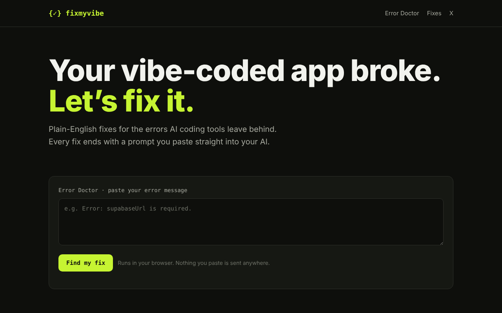
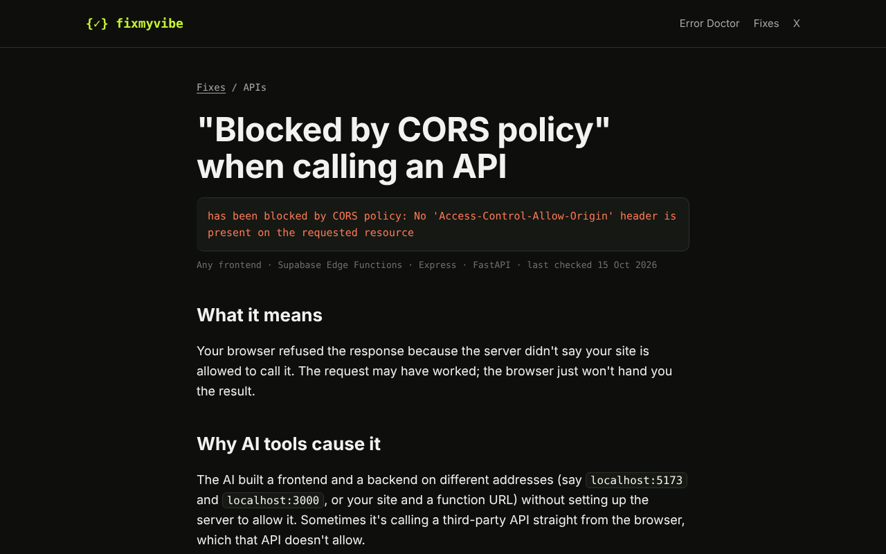

# FixMyVibe

**Live site: [fixmyvibe.org](https://fixmyvibe.org)**

Plain-English fixes for the errors AI coding tools leave behind. People building apps with Lovable, Bolt, Cursor and similar tools often hit errors they can't read. FixMyVibe explains each one in plain words and ends every fix with a prompt they can paste straight back into their AI.



## What it does

- **Error Doctor:** paste any error message and it finds the matching fix. It runs entirely in the browser, so nothing a user pastes is sent anywhere.
- **35 fixes** covering Supabase, Stripe, Vercel, React, Next.js, CORS, authentication and AI API errors. Each one follows the same structure: what it means, why AI tools cause it, how to fix it, and a ready-to-paste prompt.
- **Built for search:** each fix is its own page, written around the exact error text people search for.



## How it's built

- **Content as Markdown.** Each fix is a Markdown file in `content/fixes/` with front matter (title, error text, category, tools it applies to, date last checked).
- **Static site generator.** `build.py` (Python) turns the fixes into a fast static site in `public/`: one page per fix, the home page, a recommended-tools page, a sitemap and robots.txt.
- **Error Doctor matching.** `data/keywords.json` maps each fix to the phrases and error codes that identify it. The build bakes this into the page, and a small script scores a pasted error against it.
- **No framework, no database, no tracking scripts.** One stylesheet (`assets/styles.css`), with layouts tested down to phone width.
- **Hosting:** Vercel, deploying automatically on every push to `main`.

## Running it locally

```bash
pip install markdown pyyaml
python3 build.py              # builds the site into ./public
cd public && python3 -m http.server 8000
```

Then open http://localhost:8000.

## Adding a fix

1. Add a Markdown file to `content/fixes/`, copying the front matter from an existing one.
2. Add its matching phrases to `data/keywords.json`.
3. Run `python3 build.py` and push.

---

Built by Edward Robotham with AI coding tools: product idea, content, design and deployment.
